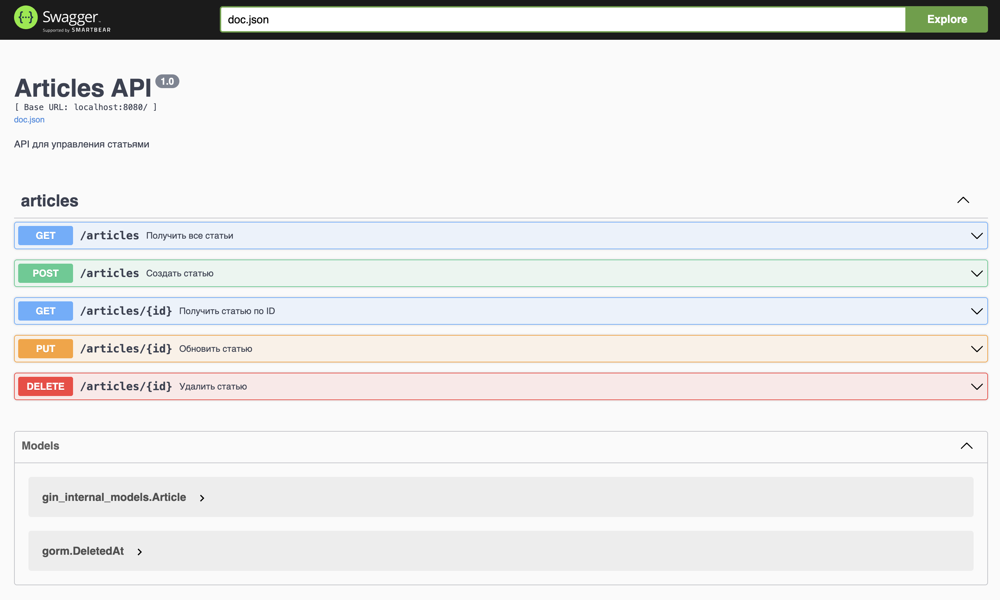

# Articles API

REST API для управления статьями на Go: **Gin + GORM + PostgreSQL + Swagger**.



## Стек

- **Go** 1.22+
- **Gin** — HTTP-фреймворк
- **GORM** — ORM
- **PostgreSQL** 15 — база данных
- **Swagger** (`swaggo`) — автодокументация
- **Docker Compose** — локальный Postgres

## Возможности

- CRUD для статей (`GET`, `POST`, `PUT`, `DELETE`)
- Автомиграция схемы через GORM
- Конфигурация через `.env`
- Интерактивная документация Swagger UI
- Soft delete (через `gorm.Model`)

## Структура проекта

```
.
├── cmd/
│   └── app/
│       └── main.go          # точка входа
├── internal/
│   ├── handlers/            # бизнес-логика (GORM-запросы)
│   └── models/              # модели данных
├── docs/                    # сгенерированная Swagger-документация
├── docker-compose.yml       # Postgres
├── .env                     # локальные переменные (не коммитится)
├── .env.example             # шаблон переменных
├── go.mod
└── README.md
```

## Быстрый старт

### 1. Клонирование

```bash
git clone https://github.com/your-username/articles-api.git
cd articles-api
```

### 2. Запуск базы данных

```bash
docker compose up -d
docker compose ps        # дождитесь статуса healthy
```

### 3. Переменные окружения

```bash
cp .env.example .env
```

Отредактируйте `.env` при необходимости:

```env
DB_HOST=localhost
DB_PORT=5432
DB_USER=user
DB_PASSWORD=password
DB_NAME=articlesdb
DB_SSLMODE=disable
DB_TIMEZONE=UTC
SERVER_PORT=8080
GIN_MODE=debug
```

### 4. Установка зависимостей

```bash
go mod download
```

### 5. Запуск

```bash
go run cmd/app/main.go
```

Сервер поднимется на `http://localhost:8080`.

## API

| Метод | Путь | Описание | Успех |
|-------|------|----------|-------|
| GET | `/articles` | Список статей | 200 |
| GET | `/articles/:id` | Статья по ID | 200 |
| POST | `/articles` | Создать статью | 201 |
| PUT | `/articles/:id` | Обновить статью | 200 |
| DELETE | `/articles/:id` | Удалить статью (soft) | 204 |

### Примеры

**Создать статью**

```bash
curl -X POST http://localhost:8080/articles \
  -H "Content-Type: application/json" \
  -d '{"title":"Первая статья","content":"Текст статьи"}'
```

**Получить все**

```bash
curl http://localhost:8080/articles
```

**Обновить**

```bash
curl -X PUT http://localhost:8080/articles/1 \
  -H "Content-Type: application/json" \
  -d '{"title":"Обновлённая","content":"Новый текст"}'
```

**Удалить**

```bash
curl -X DELETE http://localhost:8080/articles/1
```

## Swagger

Интерактивная документация доступна после запуска сервера:

```
http://localhost:8080/swagger/index.html
```